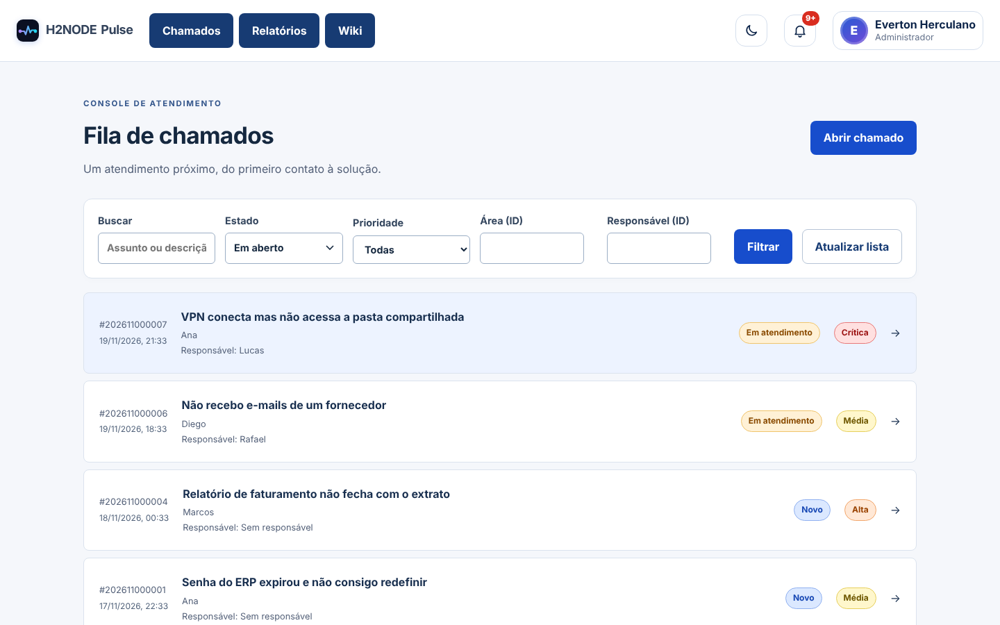

# H2NODE Pulse



Sistema de chamados (help desk) de TI para uso interno de uma empresa. Colaboradores abrem
chamados pelo navegador, a equipe de TI atende em uma fila organizada por grupos e
categorias, e a gestão acompanha prazos (SLA) e relatórios.

Tudo roda em containers Docker no seu próprio servidor. Nenhum dado sai para serviços de
terceiros, a não ser os que você configurar (e-mail, Google Chat, backup por FTP).

## O que ele faz

- **Chamados:** abertura por categoria, fila da equipe, atribuição, transferência entre
  grupos, notas internas, pausa, reabertura e avaliação do atendimento.
- **Anexos seguros:** cada arquivo passa pelo antivírus ClamAV antes de poder ser baixado.
- **Senhas ocultas:** um texto como `senha: 1234` em um chamado é cifrado e só aparece a quem
  pode ler aquele chamado.
- **Contas e acesso:** cadastro restrito aos domínios de e-mail da empresa, confirmação por
  e-mail, verificação em duas etapas (MFA) opcional e cinco papéis (Usuário, Colaborador,
  Técnico, Gestor e Administrador).
- **Avisos:** por e-mail, no Google Chat (espaço da equipe e mensagens individuais) e no sino
  do portal.
- **Gestão:** SLA por categoria, relatórios por período, exportação em CSV e log de auditoria.
- **Wiki:** base de conhecimento com páginas visíveis por área.
- **Dados:** retenção configurável (apagar dados antigos) e backup diário cifrado para FTP.

## Começar

| Quero… | Leia |
| --- | --- |
| Experimentar no meu computador | [Testar localmente](#testar-localmente), logo abaixo |
| Colocar em produção | [Instalação em produção](docs/INSTALACAO.md) |
| Configurar a empresa, e-mail e equipes depois de instalar | [Guia do administrador](docs/CONFIGURACOES.md) |
| Manter o sistema rodando (logs, atualização, senhas do banco) | [Operação](docs/OPERACAO.md) |
| Fazer e restaurar backup | [Backup](docs/BACKUP.md) |

## Testar localmente

Você precisa de Docker com Compose 2.24.4 ou mais novo e de Python 3 (só para o script de
preparação). Reserve cerca de 6 GB de memória: o antivírus sozinho usa 4 GB.

```sh
git clone https://github.com/rickdeckard82/H2NODE-Pulse.git
cd H2NODE-Pulse
python infra/bootstrap.py      # cria o .env e as senhas aleatórias em secrets/
```

Abra o `.env` e preencha o administrador inicial:

```dotenv
BOOTSTRAP_ADMIN_ENABLED=true
BOOTSTRAP_ADMIN_EMAIL=voce@suaempresa.com.br
BOOTSTRAP_ADMIN_PASSWORD=uma-senha-forte-de-8-ou-mais-caracteres
BOOTSTRAP_ADMIN_TRUST_EMAIL=true
```

Suba os serviços (a primeira vez demora alguns minutos, por causa do antivírus):

```sh
docker compose up --build --wait --wait-timeout 600
```

Acesse `http://localhost:8086` e entre com o e-mail e a senha acima. Não existe usuário nem
senha padrão. Para parar, use `docker compose down`. **Nunca use `docker compose down -v`**:
o `-v` apaga o banco e os anexos.

## Documentação

### Para quem instala e mantém

- [Instalação em produção](docs/INSTALACAO.md): servidor, proxy reverso com HTTPS, firewall.
- [Operação](docs/OPERACAO.md): logs, saúde, atualização, senhas do banco, antivírus.
- [Backup](docs/BACKUP.md): backup diário cifrado para FTP e restauração.
- [Migração do Pulse Services](docs/migracao-h2node.md): só para instalações anteriores à
  versão 0.2.0, quando o sistema se chamava Pulse Services.

### Para o administrador do sistema

- [Guia do administrador](docs/CONFIGURACOES.md): primeiro acesso, e-mail (SMTP), domínios,
  empresa, Google Chat, retenção de dados e log.

### Para quem integra ou desenvolve

- [Contas, login e MFA](docs/IDENTIDADE.md): regras e API de identidade.
- [Chamados](docs/TICKETS.md): ciclo de vida, permissões e API de chamados.
- [Portal e anexos](docs/PORTAL_ANEXOS.md): regras de upload e antivírus.
- [Contrato OpenAPI](docs/openapi.yaml).
- [Registros de decisão](docs/decisoes/README.md): por que o sistema é como é.

## Desenvolvimento

Arquitetura: backend Django + Django REST Framework, frontend React + TypeScript (Vite),
PostgreSQL 17 e Nginx como gateway. Serviços do Compose:

| Serviço | Papel |
| --- | --- |
| `db` | PostgreSQL |
| `migrate`, `db-permissions` | Rodam uma vez na subida: migrações e permissões do banco |
| `api` | API REST |
| `worker` | Envia e-mails e avisos do Chat e manda anexos para o antivírus |
| `retention` | Apaga dados vencidos, uma vez por dia |
| `antimalware` | ClamAV |
| `gateway` | Nginx: serve o portal e encaminha a API |

Modo de desenvolvimento, com recarga automática do frontend em `http://localhost:5173`:

```sh
docker compose -f compose.yaml -f compose.dev.yaml up --build
```

No Linux, a pasta `frontend` precisa ser gravável pelo UID 1000, usado pelo container Node.

Checagens sem Docker:

```sh
python -m venv .venv
.venv/bin/python -m pip install --require-hashes -r backend/requirements-dev.txt   # Windows: .venv\Scripts\python
.venv/bin/python infra/check_backend.py
cd frontend && npm ci && npm run lint && npm run build
```

Testes com Docker (não rode em produção: eles reiniciam serviços):

```sh
python tests/verify_compose.py      # valida os arquivos do Compose
python tests/smoke_docker.py        # sobe e confere o ambiente de desenvolvimento
python tests/run_identity.py        # suíte do backend em um PostgreSQL descartável
python tests/run_e2e.py             # testes no navegador; antes: cd frontend && npx playwright install chromium
```

O E2E usa a porta 8081 e grava relatórios em `work/`. Todos os testes usam dados fictícios e
não enviam mensagens para pessoas reais.

Dependências: o Python fica fixado com hashes em `backend/requirements*.txt`, gerados a partir
de `backend/requirements*.in` com
`pip-compile --generate-hashes --allow-unsafe --strip-extras`. O frontend usa versões exatas
no `package.json` e instala com `npm ci`. As imagens Docker usam versões explícitas, nunca
`latest`.

## Licença

[MIT](LICENSE).
